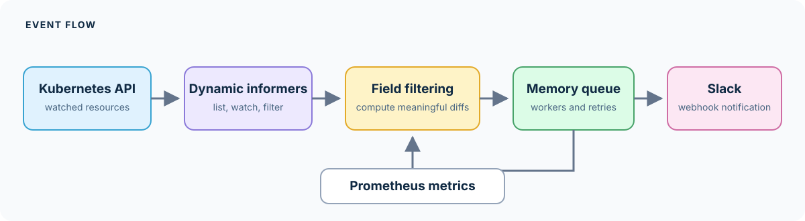
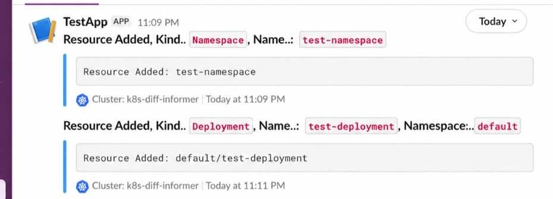
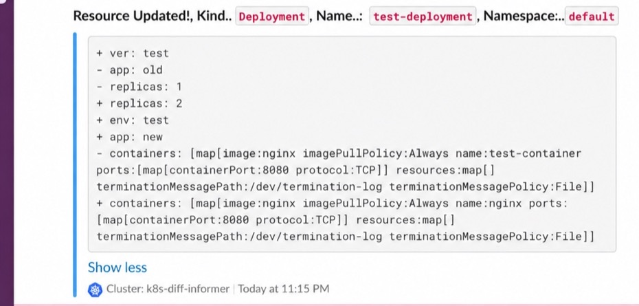
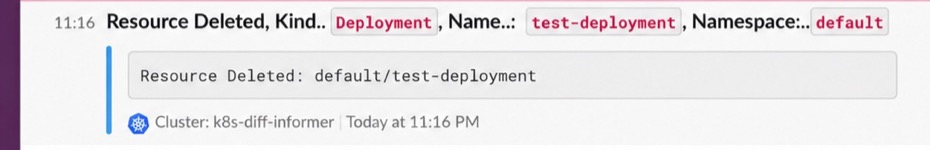
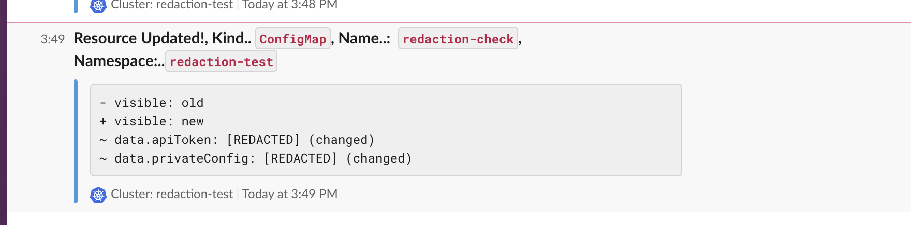
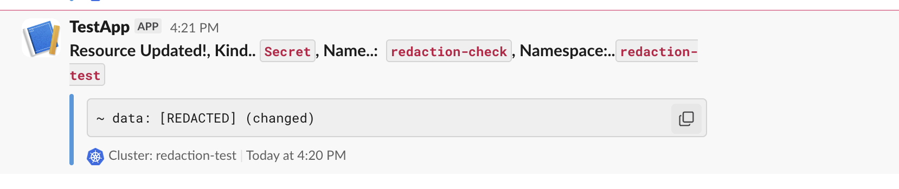

# k8s-diff-informer

**Know what changed, without digging through Kubernetes events or comparing YAML by hand.** Choose the resources to watch, ignore noisy fields, and get Slack resource change notifications with readable field diffs for additions, meaningful updates, and deletions. Built for platform and Kubernetes operators who want a lightweight change feed for selected resources. Prometheus metrics and health endpoints are included.

> **Release status:** <code>v1.0.0</code> is released. The GHCR package is public, and the Helm chart's default image <code>ghcr.io/mina-maher/k8s-diff-informer:1.0.0</code> is available for anonymous pulls on Linux <code>amd64</code> and <code>arm64</code>. See the [release artifacts](https://github.com/MIna-Maher/k8s-diff-informer/releases/tag/v1.0.0) and the [release guide](docs/RELEASING.md).

[Project website](https://mina-maher.github.io/k8s-diff-informer/) · [Website source](site/index.md) · [Installation](deployment/helm/README.md) · [Monitoring](docs/MONITORING.md) · [MIT License](LICENSE)

## What it does

- Watches only the Kubernetes resource types you choose.
- Shows readable field-level resource change diffs for meaningful updates after removing configured fields.
- Sends Slack notifications for additions, changes, and deletions, with cluster context and namespace filtering.
- Retries failed Slack deliveries through a worker queue.
- Includes Prometheus metrics, health checks, and readiness checks over HTTP.

The first informer sync populates the cache; those initial objects do not produce “added” notifications. Later adds and deletes produce notifications, while updates notify only when the computed diff is non-empty.

The tool reports object-level resource changes. Use your monitoring and alerting stack to evaluate cluster health and conditions.

## Interface

A deployment image change produces a resource change diff like this:

> **Resource Updated — Deployment <code>payments</code>, namespace <code>production</code>**
> Cluster: <code>prod-eu</code>
>
> <code>- image: payments:v4</code>
> <code>+ image: payments:v5</code>

The minus sign marks the previous value; the plus sign marks the new value. Configured ignored field paths are removed before comparison, so those fields do not appear in the resource change diff. The Slack message also includes the resource identity and cluster context.

The screenshots below show the three change types with generic demo values.

### Resource added

New-resource notifications identify the Kubernetes kind, name, namespace, and cluster.

### Resource updated

Only changed fields that remain after ignored paths are removed appear in the resource change diff.

### Resource deleted

Deletion notifications identify the removed resource and its namespace.

## Quick start with Helm

You need Helm 3, <code>kubectl</code>, access to a Kubernetes cluster, permission to create the chart's ClusterRole and ClusterRoleBinding, an image the cluster can pull, and a Slack webhook.

Create a namespace and a Kubernetes Secret from a protected local file containing the webhook URL:

~~~sh
kubectl create namespace monitoring
kubectl create secret generic informer-slack -n monitoring \
  --from-file=webhook-url=/secure/path/slack-webhook
~~~

Install from this repository:

Create <code>informer-values.yaml</code> to select resources and remove fields that commonly create noise. This example keeps the chart's default ignored paths and adds pod-template annotations:

~~~yaml
slack:
  existingSecret: informer-slack
config:
  clusterName: prod-eu
  watchedResources:
    - deployments
    - services
  watchedNamespaces:
    - production
  fieldsToRemove:
    - data.status
    - status
    - metadata.creationTimestamp
    - metadata.uid
    - metadata.resourceVersion
    - metadata.selfLink
    - metadata.managedFields
    - metadata.generation
    - metadata.finalizers
    - metadata.annotations
    - metadata.ownerReferences
    - spec.template.metadata.annotations
  fieldsToRedact:
    - spec.template.spec.containers.*.env.*.value
~~~

Redacted paths keep the change visible while masking its value in Slack. Secret
resource `data` and `stringData` values are always redacted. Common credential
field names and values for Kubernetes environment variables with credential-like
names are also masked automatically. Automatic name checks are best-effort; add
explicit paths for application-specific data, such as `data.*` for ConfigMaps
that may contain credentials. Redaction paths use dotted object paths, and `*`
matches one map key or list index. Escape a literal dot in a map key with `\.`
(for example, `data.app\.yaml`).

### Redaction examples

The ConfigMap example shows a regular field diff alongside an automatically
redacted credential-like key and a path explicitly selected for redaction:

For Secret resources, the entire `data` field is masked. Secrets are not in the
Helm chart's default watch list; enable Secret watching and grant the informer
read-only RBAC permissions if you want these notifications:

Pass that file when installing:

~~~sh
helm upgrade --install diff-monitor ./deployment/helm \
  --namespace monitoring \
  --values informer-values.yaml \
  --wait --timeout 5m
~~~

The chart uses the published stable image by default. To build from source or
use another registry, push your image and set `image.repository` and
`image.tag` explicitly:

~~~sh
docker build -t YOUR_REGISTRY/k8s-diff-informer:YOUR_TAG .
docker push YOUR_REGISTRY/k8s-diff-informer:YOUR_TAG
~~~

The GHCR package is public, so the stable <code>1.0.0</code> image can be pulled without a registry secret.

The stable <code>1.0.0</code> chart is attached to its [GitHub Release](https://github.com/MIna-Maher/k8s-diff-informer/releases/tag/v1.0.0). Stable releases created after OCI chart publishing is merged will also be available from <code>oci://ghcr.io/mina-maher/charts/k8s-diff-informer</code>. See the [release guide](docs/RELEASING.md) for version and install details.

Set exactly one of <code>slack.existingSecret</code> and <code>slack.webhookUrl</code>. The referenced Secret must exist in the release namespace, and its selected key must contain a non-empty HTTP(S) webhook URL. A chart-created Secret from <code>slack.webhookUrl</code> is stored in Helm release data; prefer an externally managed Secret for production.

See the [Helm installation guide](deployment/helm/README.md) for RBAC customization, configuration, monitoring, and troubleshooting.

## Local development

Requires Go 1.26 or newer as declared in <code>go.mod</code>, plus access to a Kubernetes cluster and a Slack webhook.

~~~sh
export SLACK_WEBHOOK_URL='https://YOUR_WEBHOOK_HOST/YOUR_WEBHOOK_PATH'
go run ./cmd/k8s-diff-informer --kubeconfig "$HOME/.kube/config"
~~~

The program uses <code>~/.kube/config</code> by default outside a cluster. Pass <code>--kubeconfig /path/to/config</code> to select another file. An explicitly empty value selects in-cluster credentials. In a pod, the application detects the service-account credential directory and uses in-cluster configuration.

Run tests and build the application with:

~~~sh
go test ./...
make build
~~~

The Helm chart has offline checks that need Helm 3:

~~~sh
python3 -B -m unittest discover -s test/helm
helm lint --strict ./deployment/helm --set slack.existingSecret=example
~~~

## Configuration

The application reads these environment variables. The Helm chart exposes the related values under <code>config</code>, <code>queue</code>, <code>metrics</code>, and <code>slack</code>.

| Variable | Default | Purpose |
| --- | --- | --- |
| <code>SLACK_WEBHOOK_URL</code> | Required | Slack webhook URL. Must be a valid HTTP(S) URL. |
| <code>CLUSTER_NAME</code> | <code>kubernetes-cluster</code> | Name included in notifications and metric labels. |
| <code>WATCHED_RESOURCE_NAMES</code> | <code>pods</code> | Comma-separated Kubernetes resource names, such as <code>pods,deployments,services</code>. |
| <code>WATCHED_NAMESPACES</code> | <code>default</code> | Comma-separated notification filter for namespaced resources. |
| <code>RESOURCES_IGNORED_FIELDS</code> | <code>data.status,status,metadata.creationTimestamp,metadata.uid,metadata.resourceVersion,metadata.selfLink,metadata.managedFields,metadata.generation,metadata.finalizers,metadata.annotations,metadata.ownerReferences</code> | Comma-separated object paths removed before comparing resources. |
| <code>RESOURCES_REDACTED_FIELDS</code> | Empty | Comma-separated object paths whose changed values are masked in Slack diffs. Supports a single-segment <code>*</code> wildcard. Secret <code>data</code>/<code>stringData</code> and common credential-like field names are redacted automatically. |
| <code>QUEUE_ENABLED</code> | <code>true</code> | Must remain enabled; synchronous delivery is not implemented. |
| <code>QUEUE_WORKERS</code> | <code>10</code> | Number of Slack delivery workers; must be positive. |
| <code>QUEUE_SIZE</code> | <code>1000</code> | Maximum buffered tasks; must be positive. |
| <code>METRICS_PORT</code> | <code>8080</code> | HTTP port for metrics, health, and readiness endpoints. |

The Helm chart's watched-resource and namespace defaults differ from the local application defaults. See its [values file](deployment/helm/values.yaml) when deploying with Helm.

## Health and monitoring

The HTTP server exposes:

- <code>/metrics</code> for Prometheus.
- <code>/health</code> and <code>/healthz</code> for process health.
- <code>/ready</code> and <code>/readyz</code> for readiness. These return HTTP 503 until all watched informer caches have synchronized, then HTTP 200. Readiness does not check Slack delivery or guarantee ongoing Kubernetes API connectivity.

The Helm chart creates a metrics Service by default. ServiceMonitor and PrometheusRule resources are disabled by default; enable them only when the Prometheus Operator CRDs are installed. See [monitoring documentation](docs/MONITORING.md).

## Important behavior and limitations

- Run exactly one replica. Each process watches the same resources independently and can send duplicate notifications. The chart uses a <code>Recreate</code> update strategy to avoid overlapping old and new pods; upgrades can cause a short interruption.
- The queue is in memory. Pending notifications can be lost when the process stops. Failed Slack deliveries are retried, but the queue is not durable.
- Namespace settings filter notifications after cluster-wide list and watch requests. They are not a Kubernetes authorization boundary.
- The default ClusterRole grants read-only access to the chart's default watched resource types and API discovery. Add matching <code>rbac.rules</code> when watching other resource types.
- Update diffs are sent to the configured Slack destination. Secret <code>data</code>/<code>stringData</code> values, common credential-like field names, and configured redaction paths are masked. Automatic name checks cannot identify every secret embedded in arbitrary values; configure <code>RESOURCES_REDACTED_FIELDS</code> for application-specific paths and restrict watched resources and Slack channel access.
- Initial informer synchronization does not generate add notifications.

## Help and contributions

- [Open an issue](https://github.com/MIna-Maher/k8s-diff-informer/issues) for bugs or feature requests.
- Read the [contribution guide](CONTRIBUTING.md) and follow the [Code of Conduct](CODE_OF_CONDUCT.md).
- Report vulnerabilities privately using the process in [SECURITY.md](SECURITY.md).
- Review the [open source release roadmap](docs/ROADMAP.md).

## License

This project is licensed under the [MIT License](LICENSE).

## Project website

The documentation site is published at <https://mina-maher.github.io/k8s-diff-informer/>. GitHub Actions builds and deploys it from <code>site/</code> whenever the published documentation changes.
